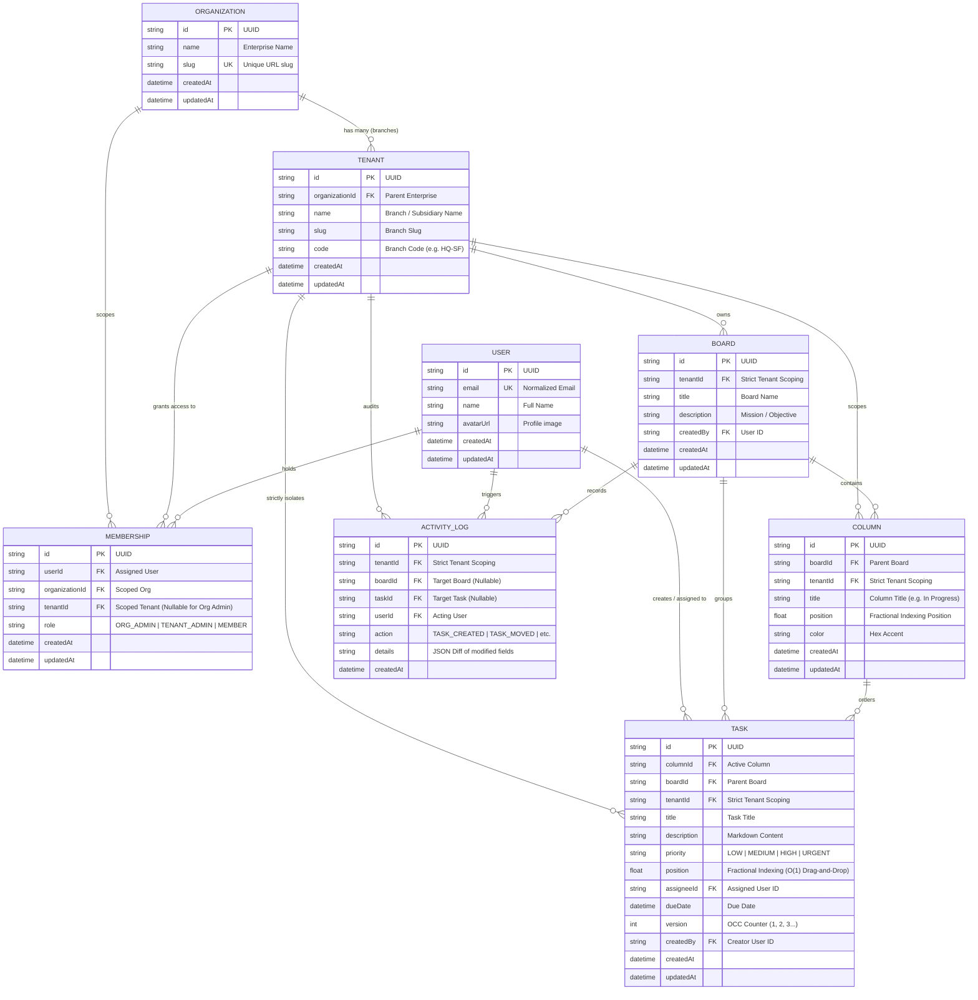

# Database Schema & Entity-Relationship (ER) Architecture

## 1. Entity-Relationship (ER) Diagram

---

## 2. Table Specifications & Indexing Strategy

### 2.1 `organizations`
Top-level enterprise entity.
- `id` (VARCHAR(36), PK): UUID
- `name` (VARCHAR(255)): Name of the enterprise
- `slug` (VARCHAR(100), UNIQUE): Unique URL identifier

### 2.2 `tenants` (Branches / Divisions)
Child entity of `organizations`. Represents individual office branches, regional subsidiaries, or isolated teams.
- `id` (VARCHAR(36), PK): UUID
- `organizationId` (VARCHAR(36), FK): Cascade on delete
- `name` (VARCHAR(255)): Branch name
- `slug` (VARCHAR(100)): Unique per organization (`@@unique([organizationId, slug])`)
- `code` (VARCHAR(20)): Human-readable code (e.g., `HQ-SF`, `LDN-RND`, `TKO-LAB`)
- **Index**: `@@index([organizationId])`

### 2.3 `users`
Global user identity. Users belong to the system and access organizations/tenants via `memberships`.
- `id` (VARCHAR(36), PK): UUID
- `email` (VARCHAR(255), UNIQUE): User email address
- `name` (VARCHAR(255)): Display name
- `avatarUrl` (VARCHAR(500), NULLABLE): Avatar photo URL

### 2.4 `memberships` (Role-Based Access Control)
Associates a `User` with an `Organization` and optionally a specific `Tenant`.
- `id` (VARCHAR(36), PK): UUID
- `userId` (VARCHAR(36), FK)
- `organizationId` (VARCHAR(36), FK)
- `tenantId` (VARCHAR(36), FK, NULLABLE):
  - When `tenantId == NULL` and `role == 'ORG_ADMIN'`, the user has org-wide privileges across **all** tenant branches in that organization.
  - When `tenantId` is set, the user's role is strictly confined to that branch.
- `role` (VARCHAR(50)): `ORG_ADMIN`, `TENANT_ADMIN`, `MEMBER`
- **Indices**:
  - `@@index([userId])`
  - `@@index([organizationId])`
  - `@@index([tenantId])`

### 2.5 `boards`
Business collection of columns and tasks, strictly owned by a `tenantId`.
- `id` (VARCHAR(36), PK): UUID
- `tenantId` (VARCHAR(36), FK): Enforces row-level isolation
- `title` (VARCHAR(255))
- `description` (TEXT, NULLABLE)
- `createdBy` (VARCHAR(36))
- **Index**: `@@index([tenantId])`

### 2.6 `columns`
Workflow steps within a board (e.g., Backlog, In Progress, Review, Completed).
- `id` (VARCHAR(36), PK): UUID
- `boardId` (VARCHAR(36), FK)
- `tenantId` (VARCHAR(36), FK): Enforces tenant verification
- `title` (VARCHAR(255))
- `position` (FLOAT): Fractional index for ordering columns
- `color` (VARCHAR(20)): Column accent color
- **Indices**:
  - `@@index([boardId, position])`
  - `@@index([tenantId])`

### 2.7 `tasks`
Individual cards containing work items.
- `id` (VARCHAR(36), PK): UUID
- `columnId` (VARCHAR(36), FK): Associated column
- `boardId` (VARCHAR(36), FK): Associated board
- `tenantId` (VARCHAR(36), FK): **Strict row-level isolation field**
- `title` (VARCHAR(255))
- `description` (TEXT, NULLABLE)
- `priority` (VARCHAR(20)): `LOW`, `MEDIUM`, `HIGH`, `URGENT`
- `position` (FLOAT): **Fractional indexing position** allowing $O(1)$ drag-and-drop reordering without table-wide locking
- `assigneeId` (VARCHAR(36), FK, NULLABLE)
- `dueDate` (DATETIME, NULLABLE)
- `version` (INT, DEFAULT 1): **Optimistic Concurrency Control (OCC) counter**
- `createdBy` (VARCHAR(36), FK)
- **Indices**:
  - `@@index([columnId, position])` (Ultra-fast column rendering)
  - `@@index([boardId])`
  - `@@index([tenantId])` (Zero cross-tenant scan leakage)

### 2.8 `activity_logs`
Append-only audit trail recording every change within a tenant branch.
- `id` (VARCHAR(36), PK): UUID
- `tenantId` (VARCHAR(36), FK): Scoped strictly to branch
- `boardId` (VARCHAR(36), FK, NULLABLE)
- `taskId` (VARCHAR(36), FK, NULLABLE)
- `userId` (VARCHAR(36), FK)
- `action` (VARCHAR(50)): `TASK_CREATED`, `TASK_UPDATED`, `TASK_MOVED`, `TASK_DELETED`, `BOARD_CREATED`
- `details` (TEXT): JSON-serialized before/after diffs
- **Indices**:
  - `@@index([tenantId, createdAt])` (Fast reverse-chronological retrieval)
  - `@@index([boardId])`
  - `@@index([taskId])`
